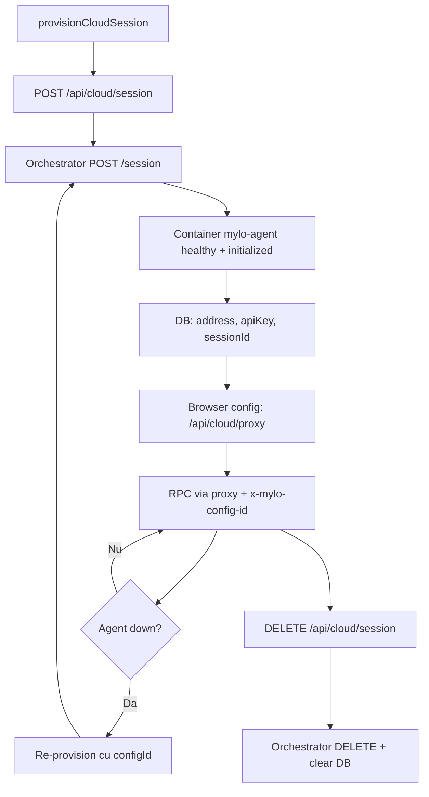

# Web Interface MYLO

**Documentație completă:** [`Documentatie.md`](../../Documentatie.md) — Partea I (Manual utilizator, Rezumat) și Partea II (detalii tehnice).

## Cuprins

- [Introducere](#introducere)
- [Arhitectura Generală](#arhitectura-generală)
- [Structura Proiectului](#structura-proiectului)
- [Pagini și Rute](#pagini-și-rute)
- [API Routes (Next.js)](#api-routes-nextjs)
- [Autentificare](#autentificare)
- [Sistem de Ferestre (Window Manager)](#sistem-de-ferestre-window-manager)
- [Client LOCAL vs CLOUD](#client-local-vs-cloud)
- [Tunnel și Proxy Cloud](#tunnel-și-proxy-cloud)
- [Client HTTP către Agent](#client-http-către-agent)
- [State Management (Zustand)](#state-management-zustand)
- [Model Editor](#model-editor)
- [Optimizare și Diagnostics](#optimizare-și-diagnostics)
- [Analiză Date](#analiză-date)
- [Asistent AI (Chat)](#asistent-ai-chat)
- [Storage (Postgres + R2)](#storage-postgres--r2)
- [Ciclu de Viață Sesiune Cloud](#ciclu-de-viață-sesiune-cloud)
- [Fluxuri End-to-End](#fluxuri-end-to-end)
- [Configurare și Variabile de Mediu](#configurare-și-variabile-de-mediu)
- [Concluzii](#concluzii)

---

## Introducere

Acest document prezintă în detaliu **Web Interface**-ul MYLO: aplicația Next.js care servește drept plan de control în browser pentru design, editare, analiză și optimizare a modelelor ML.

Web Interface-ul **nu** rulează workload-uri ML. El:

1. Autentifică utilizatorii (OAuth → sesiune JWT)
2. Gestionează configurațiile de client (agent LOCAL vs CLOUD)
3. Deschide un dashboard dockable peste un proiect susținut de agent
4. Proxiează toate RPC-urile către agent — direct (LOCAL) sau prin Next.js + container provisionat de Orchestrator (CLOUD)
5. Persistă proiecte/catalog utilizator în **Postgres + Cloudflare R2**; starea ML rămâne pe Desktop/Cloud Agent

---

## Arhitectura Generală

```
┌─────────────┐     NextAuth      ┌──────────────┐
│  Browser UI │◄─────────────────►│  Postgres    │
│  (Zustand)  │                   │  (users,     │
└──────┬──────┘                   │   configs,   │
       │                          │   projects,  │
       │ LOCAL: fetch(agent:8080) │   catalog)   │
       │ CLOUD: /api/cloud/proxy  └──────┬───────┘
       │                                 │
       ▼                                 │ metadata
┌──────────────────┐              ┌──────▼───────┐
│ Next.js API      │──────────────►│ Cloudflare R2│
│ session / proxy  │              │ .mylo / .pt2 │
│ ai / storage     │              └──────────────┘
└────────┬─────────┘
         │ X-Orchestrator-Secret
         ▼
┌──────────────────┐     Docker      ┌─────────────────┐
│ Orchestrator     │────────────────►│ Cloud Agent     │
│ :9000 /session   │                 │ (același HTTP   │
└──────────────────┘                 │  API ca Desktop)│
                                     └─────────────────┘
```

| Componentă | Responsabilitate |
|------------|------------------|
| **Web Interface** | Auth, layout, cloud files, proxy, asistent AI |
| **Orchestrator** | Lifecycle containere agent CLOUD |
| **Desktop / Cloud Agent** | Modele, CSV, optimizare, editare descriptor |

**Stack:** Next.js 16 · React 19 · Zustand · Drizzle/Postgres · NextAuth · Dockview · XYFlow · Gemini (`@google/genai`) · Cloudflare R2

---

## Structura Proiectului

```
WebInterface/webinterface/
├── src/
│   ├── app/                          # App Router
│   │   ├── page.tsx                  # Landing marketing
│   │   ├── auth/page.tsx             # Login OAuth
│   │   ├── home/page.tsx             # Hub: Projects / Clients / Catalog
│   │   ├── dashboard/page.tsx        # IDE: MenuBar + WindowManager
│   │   └── api/
│   │       ├── auth/[...nextauth]/   # NextAuth handlers
│   │       ├── cloud/session/        # Provision / teardown CLOUD
│   │       ├── cloud/proxy/[[...path]]/  # Reverse proxy către agent
│   │       ├── ai/chat/              # Gemini chat (server)
│   │       └── storage/
│   │           ├── projects/[id]/   # Download .mylo privat
│   │           └── catalog/[id]/    # Download catalog partajat
│   ├── components/
│   │   ├── windows/                  # Panouri Dockview
│   │   │   ├── WindowManager.tsx
│   │   │   ├── ModelEditor/
│   │   │   ├── FileExplorer/
│   │   │   ├── DataWindows/
│   │   │   ├── Optimization/
│   │   │   ├── Diagnostics/
│   │   │   └── Other/                # Chat, Properties, Settings
│   │   ├── pages/                    # Tab-uri Home
│   │   ├── structural/               # MenuBar, Dropdown
│   │   └── effects/                  # Hero landing
│   ├── lib/
│   │   ├── client/                   # Client, Tunnel, tipuri endpoint
│   │   ├── cloud/                    # Orchestrator client + session helpers
│   │   ├── store/                    # Zustand: client / project / workspace
│   │   ├── windows/                  # Registry ferestre, Actions, inspect
│   │   ├── ai/                       # Tools, executeTool, prompts
│   │   ├── auth*.ts                  # Login + NextAuth options
│   │   ├── db/                       # Server actions configs/projects/catalog
│   │   └── storage/                  # R2 + server actions
│   ├── db/                           # Drizzle pool, schemas, migrations
│   └── proxy.ts                      # Middleware NextAuth (/home, /dashboard)
└── next.config.ts                    # Limită body server-actions 100mb
```

---

## Pagini și Rute

| Rută | Fișier | Auth | Rol |
|------|--------|------|-----|
| `/` | `src/app/page.tsx` | Public | Landing (`HeroSection`) |
| `/auth` | `src/app/auth/page.tsx` | Public | Login GitHub/Google; redirect `/home` dacă e deja logat |
| `/home` | `src/app/home/page.tsx` | Protejat | Hub: select client, proiecte, catalog |
| `/dashboard` | `src/app/dashboard/page.tsx` | Protejat | IDE principal: MenuBar + `WindowManager` |

### Tab-uri `/home`

| Index | Componentă | Rol |
|-------|------------|-----|
| 0 | `ProjectsPage` | Proiecte cloud salvate + deschidere |
| 1 | `ConfigsPage` | Configurații client LOCAL / CLOUD |
| 2 | `CatalogPage` | Catalog partajat (proiecte / .pt2 / .onnx) |

### Bootstrap `/dashboard`

1. Așteaptă rehydratatea Zustand din `sessionStorage`
2. `connect()` cu `ClientConfig` persistat
3. Dacă CLOUD e inaccesibil → `provisionCloudSession({ configId })` o dată, reconnect
4. Opțional `?project=<name>` → `client.NewProject(name)` apoi `getProject()` + hydrate store

---

## API Routes (Next.js)

### GET | POST `/api/auth/[...nextauth]`

NextAuth standard. Providere: **Google**, **GitHub**. Strategie sesiune: **JWT**. Pagină custom: `/auth`. Callback-ul de session injectează `session.user.id = token.sub`.

---

### POST `/api/cloud/session`

**Auth:** obligatoriu (NextAuth).

**Corp cerere:**

```ts
{ name?: string; configId?: string }
```

**Comportament:**
- Cu `configId`: încarcă config CLOUD; `DELETE` sesiune orchestrator veche dacă există; creează una nouă; `updateConfig` cu `address` / `apiKey` / `sessionId` reale
- Fără `configId`: `createOrchestratorSession()` apoi `createConfig(...)`

**Răspuns succes (200):**

```json
{
  "ok": true,
  "config": {
    "name": "...",
    "type": "CLOUD",
    "address": "/api/cloud/proxy",
    "apiKey": "",
    "dbId": "<uuid>",
    "sessionId": "<orch-session>"
  }
}
```

Browserul **nu** primește cheia API reală; proxy-ul o injectează din DB.

**Erori:** `401` Unauthorized · `404` Cloud config not found · `502` Orchestrator/DB (la eșec persist, containerul creat e șters)

---

### DELETE `/api/cloud/session`

**Corp:** `{ configId: string }`

Oprește sesiunea orchestrator; golește `address`, `apiKey`, `sessionId` pe config-ul CLOUD.

**Răspuns:** `{ ok: true }`

---

### ALL `/api/cloud/proxy/[[...path]]`

**Auth:** obligatoriu.  
**Identitate:** header `x-mylo-config-id` (sau `?configId=` pentru SSE / EventSource).

**Flux:**
1. Încarcă config intern (`getConfigInternal`) — `address` + `apiKey` reale
2. Forward către `{address}/{path}` cu `Authorization: Bearer sha256(apiKey)`
3. Streamează body-ul; pasează `content-type`, `content-disposition`, `cache-control`

**Erori:** `401` · `400` missing config id · `404` not CLOUD · `409` not provisioned · `502` upstream failure

---

### POST `/api/ai/chat`

**Auth:** obligatoriu. Folosește cheia BYOK a utilizatorului (criptată) sau `GEMINI_API_KEY` ca fallback.

**Cerere (`AiChatRequest`):**

```ts
{
  contents: AiContent[];      // turn-uri stil Gemini
  projectContext?: string;    // snapshot din UI
}
```

**Răspuns (`AiChatResponse`):**

```ts
{
  text?: string;
  functionCalls?: { name: string; args: Record<string, unknown>; id?: string }[];
  modelContent?: AiContent;
  error?: string;
}
```

Serverul dezactivează function calling automat; clientul rulează tool-urile într-un loop (max 12 runde).

---

### GET `/api/storage/projects/[id]`

**Auth:** obligatoriu. Doar owner. Streamează bytes `.mylo` din R2.  
Headers: `X-File-Name`, `Content-Disposition: attachment`.

### GET `/api/storage/catalog/[id]`

**Auth:** obligatoriu. Orice user logat poate descărca iteme din catalog.  
Headers: `X-File-Name`, `X-Catalog-Kind` (`project` | `pt2` | `onnx`).

---

### Server Actions (în afara `/api`)

| Modul | Rol |
|-------|-----|
| `src/lib/db/configs.ts` | CRUD configurații client (`'use server'`) |
| `src/lib/storage/cloudProjects.ts` | list / save / delete proiecte user |
| `src/lib/storage/catalog.ts` | list / publish / delete catalog |

---

## Autentificare

1. Utilizatorul deschide `/auth` → `login("github" | "google")` → `signIn(provider, { redirectTo: "/home" })`
2. NextAuth + **DrizzleAdapter** scrie tabelele `user` / `account` / `session` (runtime-ul folosește totuși JWT)
3. `src/proxy.ts` protejează `/home` și `/dashboard`
4. `session.user.id` (= JWT `sub`) scope-uiește toate operațiile DB/R2
5. Sign-out din dropdown-ul de profil de pe `/home`

**Env tipic:** `GOOGLE_ID`, `GOOGLE_CLIENT_SECRET`, `GITHUB_ID`, `GITHUB_SECRET`, `NEXTAUTH_SECRET`, `DATABASE_URL`

---

## Sistem de Ferestre (Window Manager)

### Registry (`src/lib/windows/windowTypes.tsx`)

```ts
enum Windows {
  Visualiser, FileExplorer, ModelEditor, Settings, Chat,
  Properties, DataInfo, DataViewer, Optimization, Diagnostics
}
```

Componentele sunt mapate în obiectul `components` pentru Dockview.

### WindowManager

Folosește **dockview-react**:

1. La ready: restaurează layout din `useWorkspaceStore.getLayout(projectId)` sau default (`FileExplorer` + `Properties` dreapta)
2. Consumă panoul pending din `sessionStorage` (`queuePendingPanel` / `consumePendingPanel`) — folosit când se deschide un model din catalog pe `/home` înainte ca dashboard-ul să monteze
3. Persistă layout la fiecare schimbare: `setLayout(api.toJSON(), projectId)`

### Context de Inspectare

`useInspectablePanel` leagă panourile Visualiser/ModelEditor active de `workspaceStore.panelContexts`, astfel încât **Properties** urmărește selecția via `useActiveInspectContext()`.

### Convenții ID Panou

- `Visualiser-{slotKey}` / `ModelEditor-{slotKey}` / `Optimization-{slotKey}`
- Sloturi: `uploaded_pt2`, `uploaded_onnx`, `optimized_pt2`, `optimized_onnx`

### Roluri Ferestre

| Fereastră | Rol |
|-----------|-----|
| **FileExplorer** | Sloturi proiect, upload, vizualizare, open editor/opt, template-uri |
| **ModelEditor** | Editor graf descriptor (XYFlow) ↔ API-uri edit agent |
| **Visualiser** | Graf read-only (React Flow), alimentează Properties |
| **Properties** | Inspect nod selectat din panoul inspectabil activ |
| **Optimization** | Setup + progres SSE + raport |
| **Diagnostics** | Rulare diagnostics + raport |
| **DataInfo** | Analiză CSV (statistici, corelații, distribuții) |
| **DataViewer** | Tabel date |
| **Chat** | MYLO Assistant (Gemini + tools client-side) |
| **Settings** | Stub |

---

## Client LOCAL vs CLOUD

### Tipuri (`ClientTypes.tsx`)

```ts
enum ClientType { LOCAL = 'LOCAL', CLOUD = 'CLOUD' }

interface ClientConfig {
  type: ClientType;
  name: string;
  address: string;       // LOCAL: http://127.0.0.1:8080
                         // CLOUD (browser): "/api/cloud/proxy"
  apiKey: string;        // CLOUD browser: ""
  dbId?: string;         // id rând DB → header proxy
  sessionId?: string;    // sesiune orchestrator
  cloudEndpoint?: string;
}

const CLOUD_PROXY_BASE = "/api/cloud/proxy";
const CLOUD_CONFIG_HEADER = "x-mylo-config-id";
```

| Mod | Adresă browser | Auth | Init |
|-----|----------------|------|------|
| **LOCAL** | `http://127.0.0.1:8080` | `Bearer sha256(apiKey)` direct | `Client.Initialize()` apelează `/initialize` |
| **CLOUD** | `/api/cloud/proxy` | doar `x-mylo-config-id`; proxy adaugă Bearer | Orchestrator apelează deja `/initialize` — UI **sare** acest pas |

---

## Tunnel și Proxy Cloud

### Tunnel (`Tunnel.ts`)

Metode: `Request` · `timedRequest` · `FileRequest` · `RequestForFile` · `GetRequest`

- **LOCAL auth:** `Authorization: Bearer sha256(apiKey)`
- **CLOUD auth:** doar `x-mylo-config-id: dbId` (proxy adaugă Bearer real)
- **SSE:** `sseUrl` adaugă `?configId=` pentru EventSource (nu poate seta headere custom)

### Orchestrator Client (`orchestrator.ts`)

```ts
ORCHESTRATOR_URL || "http://127.0.0.1:9000"
Header: X-Orchestrator-Secret

createOrchestratorSession()      → POST /session
deleteOrchestratorSession(id)    → DELETE /session/{id}
cleanupOrchestratorOrphans()     → POST /cleanup
```

### Conexiune LOCAL

```
ConfigsPage creează LOCAL → DB
selectClient → clientStore.connect
  TestConnection → dacă needs_init → Initialize(hash(apiKey))
  status = "connected"
```

### Conexiune CLOUD

```
provisionCloudSession → POST /api/cloud/session
  → Orchestrator POST /session (container)
  → DB stochează address+apiKey+sessionId reale
  → config browser: address=/api/cloud/proxy, apiKey="", dbId=...
connect → health via proxy
(dacă mort) home/dashboard auto-restart via provisionCloudSession({configId})
```

---

## Client HTTP către Agent

`Client.ts` mapează metodele UI pe endpoint-urile Desktop Agent:

| Metodă Client | Path Agent |
|---------------|------------|
| `TestConnection` | `POST /` |
| `Initialize` | `POST /initialize` (doar LOCAL) |
| `OptimizationRequest` | `POST /optimizeModel` |
| `StatusUpdate` | SSE `GET /optimizationStatus` |
| `getOptimizationReport` | `GET /optimizationReport` |
| `ModelDiagnosticsRequest` | `POST /modelDiagnostics` |
| `getModelDiagnosticsReport` | `GET /modelDiagnosticsReport` |
| `LoadModel` / `LoadCSV` | `POST /loadModel` · `/loadCSV` (multipart) |
| Analiză CSV | `/advancedAnalysis`, `/correlationAnalysis`, `/chartData`, `/targetAnalysis` |
| Proiect | `/newProject`, `/getProject`, `/projectFiles`, `/visualizeProjectFile`, `/loadProject`, `/exportProject` |
| Artefacte | `/download-optimized`, `/generateOnnxFromPt2` |
| Editor | `/getModelDescriptor`, `/editModel`, `/previewEdit`, `/saveModelDescriptor`, `/visualizeModel`, `/expandModelNodes`, `/collapseModelNodes`, `/checkEdge`, `/validateModelDescriptor`, `/editor/*` |

---

## State Management (Zustand)

Trei store-uri, persistate parțial în **sessionStorage**:

### `useClientStore` (`mylo-client`)

```ts
{
  config: ClientConfig | null,
  client: Client | null,          // reconstruit la rehydrate
  status: "offline" | "connecting" | "connected"
}
// persistat: doar config
```

### `useProjectStore` (`mylo-project`)

```ts
{
  project,          // { projectData, modelData, csvData, diagnostics*, optimization* }
  csv,
  visualisation,
  optimizationRun: { result, report, updates, runError, completedAt } | null,
  diagnosticsRun:  { result, report, runError, completedAt } | null,
  descriptorDraft,  // NU e persistat — draft live pentru AI
}
```

`hydrateFromProject` normalizează payload-urile plate ale agentului în forma `projectData`.

**Formă proiect normalizată:**

```ts
{
  projectData: {
    name, id, csvFile, modelFile,
    uploadedPt2File, uploadedOnnxFile,
    optimizedPt2File, optimizedOnnxFile
  },
  modelData, csvData,
  hasDiagnosticsReport, diagnosticsReport,
  hasOptimizationReport, optimizationSummary
}
```

### `useWorkspaceStore` (`mylo-workspace`)

```ts
{
  api: DockviewApi | null,          // nu e persistat
  layoutsByProjectId: Record<string, SerializedDockview>,
  inspectablePanelId,
  panelContexts: Record<id, { selected, visualisation }>,
}
```

`resetSessionForHome()` curăță proiectul + chrome la intrarea pe `/home`.  
Cheile legacy (`activeConfig`, `loadedProject`, …) sunt migrate o dată via `migrateLegacySessionStorage()`.

---

## Model Editor

### Calea de Încărcare

1. `getEditorCatalog()` → `GET /editor/catalog` (fallback `POST /getModelEditorCatalog`)
2. `getModelDescriptor()` sau `params.descriptor` din panou
3. `visualizeModel({ descriptor, viewMode, expandedNodes })` → graf React Flow + shapes

### Calea de Editare

```ts
client.editModel({
  descriptor, operation, payload, persist, viewMode, expandedNodes
})
// → POST /editModel
```

Operațiuni folosite în UI: `add_node`, `remove_node`, `update_node`, `add_edge`, `remove_edge`.

| Acțiune UI | Endpoint |
|------------|----------|
| Previzualizare (debounce params) | `POST /previewEdit` |
| Verificare muchie înainte de connect | `POST /checkEdge` |
| Undo / Redo | `POST /editor/undo` · `/editor/redo` |
| Salvare | `POST /saveModelDescriptor` + `publishSavedModelGraph` |
| Validare | `POST /validateModelDescriptor` |

### Catalog Tipuri (`ModelEditor/types.ts`)

```ts
interface Catalog {
  nodeGroups: Record<string, string[]>;
  nodeParameterBlueprints: Record<string, Record<string, CatalogParamBlueprint>>;
  nodePorts: Record<string, CatalogNodePorts>;
  nodeSchemas: Record<string, Record<string, any>>;
  limits?: { maxNodes?: number; maxDepth?: number };
  insertableTypes?: string[];
  swappableActivations?: string[];
}
```

### Sincronizare AI

Descriptorul local e oglindit în `projectStore.descriptorDraft` ca tool-urile AI să vadă editările nesalvate. Tool-urile AI apelează aceleași metode `Client` și emit `mylo:model-edited` (`notifyModelEdited`); ModelEditor ascultă via `onModelEdited` și re-randerează.

### Componente Editor

| Fișier | Rol |
|--------|-----|
| `ModelEditor.tsx` | Wrapper panou |
| `ModelEditorInner.tsx` | Canvas XYFlow + logică edit |
| `PortedNode.tsx` | Nod cu porturi input/output |
| `NodeSettingsPanel.tsx` | Editare parametri nod |
| `ModelContextMenu.tsx` | Meniu contextual (add/remove/…) |
| `helpers.ts` | Transformări graf / utilitare |

---

## Optimizare și Diagnostics

### Optimizare

```
Optimization panel → beginOptimizationRun()
  → EventSource(/optimizationStatus)   // SSE
  → POST /optimizeModel
  → appendOptimizationUpdate per eveniment
  → setOptimizationResult + GET /optimizationReport
```

**Evenimente SSE:** `phase`, `status`, `progress`, `complete`, `error`

**State run (`OptimizationRunState`):**

```ts
{
  result: OptimizationReport | null,
  report: OptimizationReport | null,
  updates: ProgressUpdate[],
  runError: string | null,
  completedAt: number | null,
}
```

Raportul include: rezumat strategie, diferențe arhitectură, istoric antrenament, linie de moștenire (neuroevoluție), mutații, verdict improved/regressed.

### Diagnostics

Panoul Diagnostics apelează `POST /modelDiagnostics` și apoi `GET /modelDiagnosticsReport`, stocând rezultatul în `diagnosticsRun`.

---

## Analiză Date

| Acțiune UI | Endpoint Agent |
|------------|----------------|
| Upload CSV | `POST /loadCSV` |
| Analiză avansată | `POST /advancedAnalysis` |
| Matrice corelație | `POST /correlationAnalysis` |
| Date grafice | `POST /chartData` |
| Analiză țintă | `POST /targetAnalysis` `{ targetColumn }` |

**DataInfo** afișează statistici descriptive, corelații, distribuții, calitate date.  
**DataViewer** afișează tabelul (DataTable).  
**Charts** generează vizualizări din `chartData`.

---

## Asistent AI (Chat)

### Loop de Execuție (`Chat.tsx`)

```
text user
  → POST /api/ai/chat { contents, projectContext }
  → dacă functionCalls: executeAiTool (browser) pentru fiecare
  → append functionResponse ca turn user
  → repetă ≤ 12 runde
```

`buildProjectContextSnapshot()` trimite un rezumat al proiectului curent către model.

### Tools Disponibile

| Tool | Efect |
|------|-------|
| `get_project_overview` | Rezumat store (nume, sloturi, status opt) |
| `get_model_descriptor` | Draft sau descriptor agent |
| `get_model_graph_summary` | Noduri/muchii vizualizare |
| `get_csv_summary` | CSV trunchiat |
| `get_editor_catalog` | Catalog tipuri noduri |
| `get_optimization_status` | Run din store |
| `edit_model` / `preview_edit` | API edit + `notifyModelEdited` |
| `validate_model` / `save_model` | Validate/save + publish graf |
| `undo_model_edit` / `redo_model_edit` | Istoric agent |
| `open_dashboard_panel` / `list_open_panels` | Dockview |
| `refresh_project` | `getProject` + hydrate |

System prompt (`systemPrompt.ts`) forțează ordinea: descriptor → catalog → edit (+rewire) → validate → save → răspuns text.

Model implicit: `GEMINI_MODEL` sau `gemini-2.5-flash`.

### BYOK (Bring Your Own Key)

Utilizatorii își pot adăuga cheia Gemini în panoul **Settings**:
1. Server action verifică cheia live la Google
2. Envelope encryption (AES-256-GCM + DEK wrap via `BYOK_MASTER_KEY` sau AWS KMS)
3. Doar ciphertext în Postgres (`userllmkeys`); UI vede doar fingerprint (`…xxxx`)
4. `/api/ai/chat` decriptează per request, cu rate-limit per user; fallback opțional la `GEMINI_API_KEY`

---

## Storage (Postgres + R2)

### Scheme DB (`userData.ts`)

```ts
clientConfigs   // address, apiKey, type, name, sessionId, userId
cloudProjects   // name, description, cloudSaved, cloudPath
catalogItems    // kind: project|pt2|onnx, fileName, cloudPath
userSettings    // theme, language
userLlmKeys     // BYOK Gemini key (envelope-encrypted ciphertext only)
```

### R2 (`r2bucket.tsx`)

Client S3 (`R2_BUCKET_ENDPOINT`, keys, `R2_BUCKET_NAME`).  
Metode: `uploadFile` · `getFileBytes` · `deleteFile`.

### Proiecte Cloud Private

- Path: `{userId}/projects/{name}.mylo`
- Tabel: `cloudprojects`
- **Salvare:** agent `exportProjectBlob` → FormData → `saveMyCloudProject` (server action)
- **Deschidere:** `GET /api/storage/projects/:id` → `client.loadProject(file)` → hydrate → `/dashboard`

### Catalog Partajat

- Path: `catalog/{userId}/{itemId}/{file}`
- Tabel: `catalogItems` — `kind: project | pt2 | onnx`
- Listarea e globală (toți userii); ștergerea doar pe itemele proprii
- **Deschidere:** download → `loadProject` sau `LoadModel` + panou pending ModelEditor/Visualiser

> Agentul **nu** vorbește cu R2; doar serverul Next.js are credențiale.

---

## Ciclu de Viață Sesiune Cloud

| Pas | Acțiune |
|-----|---------|
| **Creare** | UI `provisionCloudSession({ name })` → API creează sesiune orch + rând DB |
| **Utilizare** | Browser vorbește doar cu `/api/cloud/proxy` + `dbId` |
| **Restart** | Același API cu `configId` — șterge containerul vechi, provisionează unul nou, update DB |
| **Auto-heal** | Home/Dashboard la eșec connect pe CLOUD |
| **Teardown** | `DELETE /api/cloud/session` sau ștergere config (și teardown) |
| **Anti-orphan** | Dacă scrierea DB eșuează după create orch → șterge sesiunea |



---

## Fluxuri End-to-End

### A. LOCAL: UI → Desktop Agent

```
UI Client(address=http://127.0.0.1:8080, apiKey)
  → Tunnel Bearer sha256(apiKey)
  → Desktop Agent HTTP API
```

### B. CLOUD: UI → Proxy → Agent

```
UI Client(address=/api/cloud/proxy, dbId)
  → Next proxy (session + DB lookup)
  → Agent container + Bearer sha256(realKey)
Orchestratorul e implicat doar la provision/teardown, nu per-RPC.
```

### C. Optimizare

```
Optimization panel → beginOptimizationRun()
  → EventSource(/optimizationStatus)
  → POST /optimizeModel
  → appendOptimizationUpdate per SSE
  → setOptimizationResult + GET /optimizationReport
```

### D. Round-trip proiect cloud

```
Save: Agent exportProject → Blob → R2 + cloudprojects row
Open: R2 download API → File → Agent loadProject → getProject → hydrate → /dashboard
```

### E. Editare model via AI

```
Chat → Gemini (tools) → executeAiTool(edit_model)
  → Client.editModel → Agent /editModel
  → notifyModelEdited → ModelEditor canvas + descriptorDraft
  → save_model → publishSavedModelGraph → panouri Visualiser
```

### F. Deschidere din Catalog

```
CatalogPage → GET /api/storage/catalog/:id
  → File → loadProject SAU LoadModel
  → queuePendingPanel(ModelEditor/Visualiser)
  → navigate /dashboard → WindowManager consumă pending panel
```

---

## Configurare și Variabile de Mediu

```env
# Orchestrator
ORCHESTRATOR_URL=http://127.0.0.1:9000
ORCHESTRATOR_SECRET=dev-secret

# Cloudflare R2
R2_BUCKET_ENDPOINT=...
R2_ACCESS_KEY_ID=...
R2_SECRET_ACCESS_KEY=...
R2_BUCKET_NAME=mylo

# Database
DATABASE_URL=...

# AI
GEMINI_API_KEY=...                 # platform fallback (opțional dacă toți userii au BYOK)
GEMINI_MODEL=gemini-2.5-flash   # opțional
BYOK_MASTER_KEY=...               # obligatoriu pentru stocare BYOK (openssl rand -hex 32)
# BYOK_KMS_KEY_ID=arn:aws:kms:... # opțional: wrap DEK cu AWS KMS
# AI_RATE_LIMIT_PER_MINUTE=30

# NextAuth / OAuth
GOOGLE_ID=...
GOOGLE_CLIENT_SECRET=...
GITHUB_ID=...
GITHUB_SECRET=...
NEXTAUTH_SECRET=...
NEXTAUTH_URL=http://localhost:3000
```

`next.config.ts` crește limita body pentru server-actions la **100mb** (upload-uri `.mylo` mari).

### Pornire Development

```bash
npm run dev
# http://localhost:3000
```

---

## Concluzii

Web Interface-ul MYLO este planul de control al ecosistemului: autentificare, workspace dockable, editor vizual de arhitecturi, analiză date, optimizare cu feedback live, asistent AI cu tool-uri pe agent, și stocare cloud (R2 + Postgres). Separarea clară față de Agent (ML) și Orchestrator (lifecycle containere) permite același UI să lucreze atât cu un Desktop Agent local, cât și cu agenți CLOUD efemeri, fără a expune chei sau adrese reale către browser.
